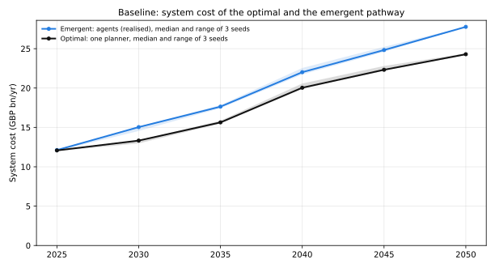

# pypsa-gb-abm — agent-based GB electricity market model linked to PyPSA-GB

A modular Python (Mesa + PyPSA) agent-based model of the **GB electricity market** — hourly operation
(bidding, dispatch, pricing) and annual investment (technology choice, expectations, CfD / Capacity
Market / carbon policy) — linked to [PyPSA-GB](https://github.com/andrewlyden/PyPSA-GB) data and its
zonal network, with **multi-energy coupling** to heat (household heat-pump agents), gas networks, EVs
and hydrogen.

> ⚠️ Prototype. The 2025 operating year is calibrated against GB outturn ([table](results/calibration_2025.md));
> the 2026-2050 pathway is not validated and numbers are illustrative. See [assumptions](docs/assumptions.md).

* Research: [literature review](docs/research/literature_review.md) ·
  [capability-vs-challenge matrix](docs/research/capability_matrix.md) ·
  [gap analysis](docs/research/gap_analysis.md)
* Design: [model design](docs/model_design.md) · [assumptions & limitations](docs/assumptions.md)
* Optimal vs emergent: [the gap](docs/gap.md) · [roadmap: what the model is missing](docs/roadmap.md)

## Quick start
```bash
pip install -e .            # numpy pandas scipy matplotlib mesa pypsa highspy
pytest -q                   # 89 tests (+1 slow), ~12 min
python scripts/run_scenarios.py baseline --end 2030      # ~40 s
python scripts/run_scenarios.py                          # all 6 scenarios 2025-2050 (~4 min each)
python scripts/make_plots.py                             # -> docs/figures/
python scripts/compare_outturn.py                        # 2025 vs GB outturn -> results/calibration_2025.md
python scripts/run_ensemble.py                           # baseline, no_cfd, heat_push x 5 seeds
python scripts/run_gap.py                                # optimal vs emergent: planner, ladder, levers (hours)
python scripts/run_convergence.py                        # convergence test: competitive benchmark vs the optimum
python scripts/build_docs.py --open                      # README and docs/ as HTML in a browser (pip install markdown)
# optional: rebuild the outturn reference / neighbour prices (public APIs, no key)
python scripts/fetch_outturn.py 2024 2025 && python scripts/fetch_neighbour_prices.py 2024
# optional: rebuild the PyPSA-GB snapshot / run on a live clone
python scripts/extract_pypsagb_snapshot.py /path/to/PyPSA-GB
python scripts/run_scenarios.py baseline --pypsa-gb /path/to/PyPSA-GB
```
```python
from ukabm import GBMarketModel, get_scenario
m = GBMarketModel(get_scenario("heat_push"), end=2040, seed=1)
df = m.run()            # annual metrics: prices, mix, emissions, policy costs, HP/EV stock, gas tariffs
```

## Layout
```
ukabm/config.py        technologies, fuels, policy parameters (indicative)
ukabm/agents.py        GenCo agents (offers, CfD/CM bids, NPV investment), Plant
ukabm/decisions.py     decision interface: DecisionMaker, RuleBased (default), registry (`decision_logic`)
ukabm/observations.py  what a firm may know (Observation), action spaces, rewards (Outcome)
ukabm/institutions.py  government agent: CfD round settings (volume, £ budget, caps); `fixed` | `targets`
ukabm/market.py        vectorised hourly clearing, storage arbitrage, valley-filling
ukabm/model.py         GBMarketModel (Mesa): annual loop, auctions, settlement, investment
ukabm/multienergy.py   HeatModule (household agents), GasNetworkModule, EVModule, HydrogenModule
ukabm/network.py       BM-style redispatch (bids/offers) on the PyPSA-GB zonal network, ETYS boundary limits
ukabm/data/pypsagb.py  PyPSA-GB adapter (raw clone or bundled snapshot)
ukabm/scenarios.py     baseline, high_carbon, no_cfd, heat_push, no_capacity_market, high_gas
ukabm/outturn.py       model-vs-outturn comparison (data/outturn: NESO generation mix + CI, Elexon)
ukabm/ensemble.py      multi-seed runs (run_ensemble, parallel) and per-year bands
ukabm/costs.py         system-cost accounting shared by every run (resource cost; transfers cancel)
ukabm/planner.py       the optimum: PyPSA multi-period capacity expansion; least-cost evaluator dispatch
ukabm/gap.py           optimal vs emergent: gap runs, investment/operation split, ladder of agent frictions
```

## 2025 calibration (baseline, seed 42) vs GB outturn
| | model | outturn 2025 |
|---|---|---|
| price, time-weighted mean (£/MWh) | 83.9 | 79.9 (Elexon MID) |
| carbon intensity, NESO basis: wholesale / after BM redispatch (g/kWh) | 113 / 122 | 130 (NESO, generation-weighted) |
| gas / wind after BM redispatch (TWh) | 75 / 88 | 77 / 86 |
| nuclear / biomass (TWh) | 35 / 20 | 34 / 20 |
| imports / exports (TWh) | 45 / 15 | 44 / 15 (Elexon FUELHH) |
| constraint cost (£bn) | 0.70 | 1.83, of which ~0.54 BM premia not modelled (LCP Delta 2026, NESO data) |
| renewable turn-down in the BM (TWh) | 6.9 | 10.4 |

The network stage redispatches the copperplate schedule on the PyPSA-GB zones with dated ETYS boundary
capabilities. It turns down Scottish wind behind B4/B6 and turns up gas in England, which closes half of the CI gap.
Interconnector flows enter at their landing zones (mostly southern England), so Scottish demand is not
netted by imports; constraint cost is ~45 % and turn-down ~35 % below outturn (excluding BM premia).
Remaining residuals: the model has no CHP/waste "other" generation (4.7 TWh, ~+5 g/kWh) and its price
distribution is too narrow (no negative hours). Full table: [results/calibration_2025.md](results/calibration_2025.md).

## Optimal versus emergent: the gap (illustrative)
The same system solved two ways: the agents (many actors, today's market design) and a PyPSA
multi-period least-cost plan (one planner, perfect foresight, 3.5 %), both costed by one least-cost
dispatch over 8,760 h ([method and results](docs/gap.md)). Present value of system cost 2025–2054, £bn,
median of 3 seeds:

| run | optimal | agents | gap [range] | of which investment / operation | gap % |
|---|---|---|---|---|---|
| baseline (full agents) | 321 | 352 | 32 [31–32] | 28 / 4 | 9.9 |
| baseline, idealised agents | 320 | 356 | 36 [34–38] | 33 / 3 | 11.2 |
| no_cfd | 318 | 375 | 58 [56–59] | 56 / 2 | 18.2 |
| no_capacity_market | 319 | 337 | 18 [16–18] | 14 / 4 | 5.6 |
| heat_push | 390 | 425 | 35 [35–37] | 32 / 3 | 9.0 |
| high_carbon | 310 | 346 | 36 [35–37] | 32 / 4 | 11.6 |
| high_gas | 354 | 392 | 38 [37–39] | 33 / 5 | 10.7 |
| competitive_benchmark (convergence test) | 315 | 323 | 10 [8–13] | 4 / 6 | 3.3 |

* The gap is mostly **what is built**: too little solar and onshore wind by 2030, then too much
  offshore wind, OCGT and batteries by 2050 (88 against 40 GW offshore), while the optimum builds
  onshore wind and gas CCS. The agents' system emits more than the optimum throughout.
* **Firm traits barely move it, but mostly because they cannot.** Renewable volumes are set by the CfD
  parameters (6 GW/yr, 60/20/20; bids never reach the caps) and firm capacity by the CM target formula,
  so firms decide who builds, not how much. Idealised firms leave a larger gap (£36bn). Items 1–7 make
  the government, the system operator and the firms' bids real decisions; the headline runs do not
  use them yet.
* **CfDs keep the system near the optimum** (without them the gap nearly doubles); the **Capacity
  Market** as modelled overshoots (without it the gap halves, at the cost of some loss of load).
* **Under textbook conditions the agents get within 3.3 % of the optimum** (energy-only market,
  idealised merchant firms on lifetime forecasts; median of 3 seeds), mostly operation rather than
  investment, with very different fleets at nearly the same cost (a flat, near-optimal cost surface).
  Matched build limits, consistent battery services and better storage dispatch would shrink it.
* The optimum has no reserve or response requirement and sees one weather year, which overstates the
  gap (25 GW of batteries alone ≈ £1.5bn/yr in 2050); see the caveats in [docs/gap.md](docs/gap.md).




## Scenario results (illustrative)
Ensembles, median [min–max] of seeds 1–5 ([results/ensemble_summary.md](results/ensemble_summary.md)). Seeds vary
agent and path draws, not weather, demand, fuel or carbon paths.

| scenario | price 2030 (£/MWh) | price 2050 (£/MWh) | CI 2050 (g/kWh) | LOLE total 2025-50 (h) | HP homes 2050 (m) | offshore wind 2050 (GW) |
|---|---|---|---|---|---|---|
| baseline | 88 [86–90] | 44 [43–46] | 13 [13–14] | 0 [0–0] | 8.0 [7.7–8.3] | 87 [84–89] |
| heat_push | 92 [91–95] | 58 [55–60] | 22 [19–23] | 0 [0–30] | 27.3 [27.3–27.5] | 87 [84–89] |
| no_cfd | 92 [91–95] | 85 [84–88] | 29 [28–31] | 0 [0–0] | 5.8 [5.0–6.0] | 3 [0–5] |

All scenarios, seed 42:

| scenario | price 2030 / 2050 (£/MWh) | CI 2050 (g/kWh), direct (NESO basis) | LOLE total 2025-50 (h) | HP homes 2050 | batteries 2030 / 2050 (GW) |
|---|---|---|---|---|---|
| baseline | 87 / 44 | 13 (20) | 0 | 8.4 m | 6 / 26 |
| high_carbon (£300/t 2050) | 94 / 47 | 7 (11) | 0 | 7.6 m | 7 / 28 |
| no_cfd | 92 / 85 | 27 (40) | 0 | 5.9 m | 5 / 6 |
| no_capacity_market | 93 / 57 | 11 (17) | 79 | 7.0 m | 7 / 16 |
| heat_push (£11.5k grant, £25/MWh levy rebalancing) | 92 / 57 | 20 (27) | 0 | 27.5 m | 6 / 24 |
| high_gas (central gas path + £15/MWh_th) | 112 / 61 | 18 (25) | 0 | 15.5 m | 7 / 35 |

The central gas path now includes the 2026 spike (£55/MWh_th in 2026, £63 in 2027, easing to £35 by 2030;
[assumptions](docs/assumptions.md)), so wholesale prices peak at ~£150/MWh in 2027 in every scenario. CfDs
drive offshore wind and lower long-run prices; without a Capacity Market, loss of load appears from the late 2030s
(79 h over 2033–50) rather than as an early scarcity episode; high gas prices and levy rebalancing both accelerate
heat-pump uptake, which raises winter peak and carbon intensity until the fleet catches up. Loss-of-load hours
are seed-dependent (0–30 h across seeds in heat_push) and should not be quoted from one seed.


## STATUS / roadmap

| area | status |
|---|---|
| Hourly GB market clearing (agent offers, ORDC scarcity) | ✅ works, unit-tested |
| Interconnectors: per-market import offers + export bids on observed 2024 neighbour price shapes | ✅ works; calibrated to 2025 flows (45/15 TWh vs 44/15) |
| 2025 calibration vs outturn (`scripts/compare_outturn.py`) | ✅ price +6 %, gas/imports/exports/nuclear/biomass within 10 %; CI (NESO basis) −13 % with explained residuals (curtailment, "other") |
| Storage arbitrage (battery, pumped hydro), smart EV valley-filling, electrolysers | ✅ works (heuristic, perfect intra-day foresight; storage fleet dispatched in price-aware tranches) |
| Merchant investment (5 heterogeneous GenCos, NPV on re-forecast prices) | ✅ works |
| Decision interface (`ukabm.decisions`): every GenCo decision behind one `DecisionMaker`, selectable per scenario and GenCo | ✅ rules by default, results unchanged; ready for government, Q-learning and LLM decision makers |
| CfD allocation rounds with pots; 2-way CfD settlement | ✅ works. ⚠️ Volume fixed at 6 GW/yr (60/20/20) with no £ budget; bids (levelised cost ± noise) never reach the caps, so the auction decides who builds, not how much (roadmap items 2–3) |
| Government / system operator as agents (CfD budgets, CM target, rule changes) | ⚠️ CfD government done (`ukabm.institutions`: `fixed` default, `targets` with £ budget, adaptive caps, levy guard); not yet the default in the headline runs. System operator for the CM done (`standard`: reliability standard and T-1) |
| T-4 Capacity Market with sloping demand curve | ✅ works (no T-1, no penalties); fixed Nov 2026: no acceptance beyond the end of the demand curve, new-build bids on the t+3 forecast. ⚠️ default target ~25 % above published; `system_operator: "standard"` matches it (39.5 vs 39.4 GW, delivery 2029) |
| Retirement on persistent losses / end of life | ✅ works |
| PyPSA-GB link: zonal network, ESPENI profiles, DUKES siting, IC register, CM/CfD data | ✅ works (bundled snapshot or live clone) |
| Network stage: BM-style redispatch (bids/offers) on PyPSA-GB zones with dated ETYS boundary capabilities and monthly availability, 96 wind-stratified hours | ✅ 2025: £0.70bn vs £1.29bn outturn excl. BM premia; 6.9 vs 10.4 TWh turn-down; post-BM gas/wind within 3 TWh, CI 8 g/kWh low. Boundary cuts tested for bypass routes; IC flows at landing zones. Siting by resource share (national pricing); LMP siting is the `locational_signal` sensitivity. ⚠️ Single GB wind shape for all zones; ~£0 in 2030 (see roadmap); redispatch is reported only, not settled or passed to consumers (no BSUoS) |
| Heat-pump household agents + gas network tariff feedback | ✅ works (stylised, synthetic temperature) |
| Hydrogen: electrolysers + H2 turbine tech | ⚠️ stub-level: exogenous H2 price, no H2 storage/network |
| Batteries: revenue stack (day-ahead arbitrage + ancillary and intraday/BM pots shared across the fleet + CM) | ✅ 2025 stack £64k/MW/yr before CM (Modo index £73k incl. CM); batteries enter via CM (stepwise supply curve: each chunk counts the batteries ahead of it) and merchant NPV, 5–7 GW by 2030 and 16–35 GW by 2050 (6 GW without CfDs); the 2030 fleet earns about its entry cost (£76k/MW/yr), 2040–50 ~75–80 %. ⚠️ Stylised pots (2050 fleet scales with the trading pot: 15 / 24 / 33 GW at ×0.5 / ×1 / ×1.5), not charged to consumers (`battery_services_bn`); low against Clean Power 2030 (23–27 GW by 2030) |
| Strategic BM bidding, nodal/ETYS network in loop, RL agents | ❌ not started |
| Price distribution | ⚠️ too narrow: no negative hours (244 in 2025), p05 £54 vs £9, p95 £100 vs £123 (no unit commitment / must-run, no scarcity tail) |
| Multi-seed Monte-Carlo (`run_ensemble`, band plots) | ✅ 5 seeds for baseline, no_cfd, heat_push; other scenarios seed 42 |
| System cost (resource cost, `syscost_*` columns) and planner benchmark (`ukabm.planner`) | ✅ PyPSA multi-period LP on the same inputs; least-cost evaluator for both pathways. ⚠️ copperplate, one weather year, electricity only (demand held at the agents' values) |
| Gap ladder (idealised agent trait groups) and policy levers (`ukabm.gap`, `scripts/run_gap.py`) | ✅ 3 seeds; see [docs/gap.md](docs/gap.md) |
| Back-casts 2020–24, weather years, CI tolerance test | ❌ not started (2025 only) |

**Next (priority order)**

The project's focus is the gap between the optimal and the emergent system ([docs/gap.md](docs/gap.md)):
how large it is, where it comes from, and which market designs and plans close it. The first measurement
showed that the model cannot yet say where the gap comes from, because the CfD volume, the Capacity
Market target and the carbon price are fixed parameters rather than decisions anyone makes. The roadmap
therefore starts by making those decisions real. Rationale for every item: [docs/roadmap.md](docs/roadmap.md).

The daily agent takes the highest unfinished item it can complete in one run; a large item may be split
over several PRs, each leaving the model working. After any item that changes agent or planner behaviour,
re-run `scripts/run_gap.py` and update [docs/gap.md](docs/gap.md).

*A. Who decides*

0. **Fix the verified findings of the 27 Nov code review** ([docs/review_2026-11.md](docs/review_2026-11.md)).
   Fixed with tests (`tests/test_review_fixes.py`): CM bids and agreements (A1, A2), smart-EV energy (A3),
   sunk capex (A4), RO end (A5), legacy CfD strikes (A6), margin price years (A7), long-horizon forecasts
   (A8–A10), budgets (A11), the planner's storage time step and sample (D1, D2), and B1, B2, B5, B6, B10,
   D6, D7, D9. Still open: B3 (item 9), B4 curtailment ties, B7 interconnector CM payments, B8, B9 zonal
   demand shares, D4 planner mothballing, D5 annual costing, calibration honesty and result provenance
   (section C). Then re-run scenarios, ensembles, the gap and the convergence test.
1. ✅ **Decision interface (deck slide 16).** Done: `ukabm/decisions.py`. GenCo offers, carbon
   expectations, merchant investment, CfD and CM bids go through a `DecisionMaker`; scenario key
   `decision_logic` selects one by name, for all or named GenCos; `RuleBased` reproduces the earlier
   results exactly (`tests/test_decisions.py`). Items 2, 5, 6, 24 and 25 plug into it.
2. ✅ **Government agent and a £-budget CfD auction.** Done: `ukabm/institutions.py` (`fixed`, the
   original 6 GW/yr rule and default; `targets`, tracking `config.CFD_TARGET_GW` with a £ budget per pot
   at the expected strike, caps raised after a failed round, budgets cut above a £30/MWh levy). Tests in
   `tests/test_government.py`. `targets` becomes the default once items 3–6 are in, and the gap is
   re-run then.
3. ✅ **CfD bids from expectations.** Done: `decision_logic: "expectations"` (`ExpectationBids` in
   `ukabm/decisions.py`): lowest strike meeting the hurdle rate over a 20-year CfD plus a merchant tail
   valued at the firm's own capture-price view; risk premium; firms abstain above the cap. Withdrawal
   after winning waits for cost trajectories (item 19). Becomes the default with item 2's `targets`.
4. ✅ **Merchant and PPA renewables; lifetime forecasts.** Done in `decision_logic: "expectations"`:
   NPV on a margin path (t+3, t+8, t+13; `GBMarketModel.forecast_horizons`, with an adequate fleet and
   wind/solar growing at their recent rate), wind and solar buildable merchant or on a 15-year PPA
   alongside CfDs. Becomes the default with items 2–3 after items 5–6.
5. ✅ **System operator agent for the Capacity Market.** Done: `ukabm.institutions.SystemOperator`,
   `system_operator: "standard"` sets the T-4 target from the 3 h LOLE standard on delivery-year net
   demand (supported wind and solar by their hourly output) with 5 % held back for a T-1 auction:
   39.5 GW at T-4 for delivery 2029 against 39.4 GW published (the old formula: 49.4 GW). Default
   stays `formula` until items 2–6 switch together.
6. ✅ **Government objectives as levers.** Done: `government: "least_cost"` (tracks the planner's
   wind and solar pathway; the ideal-government rung), `"bills"` (lowest levy, slips when bills
   rise) and `"political"` (ambitious announcements, little funding before elections). Parameters in
   `config.GOVERNMENT_*`, documented in `docs/model_design.md`.
7. ✅ **Convergence test.** Done: scenario `competitive_benchmark` (`scenarios.BENCHMARKS`; energy-only,
   VoLL scarcity only, idealised firms on the `expectations` logic) and `scripts/run_convergence.py`.
   3 seeds to 2050: gap 2.6–4.1 % (median 3.3 %), mostly operation, with very different fleets at
   nearly the same cost (item 10). An upper bound: build limits differ (item 20), battery services
   (item 9) and heuristic storage dispatch ([docs/gap.md](docs/gap.md#convergence-test-can-the-agents-reach-the-optimum-at-all)).

*B. A fair benchmark*

8. **Speed.** Profile a gap run (forecast market clearings, planner LP, evaluator) and halve the batch
   time, e.g. by caching or reduced-hour forecasts. Items 14–17 and section D need many more runs.
9. **Reserve and response in the optimum.** Agents build batteries partly for ancillary and intraday/BM
   revenue (`config.BATTERY_*` pots), but the planner and the evaluator have no reserve or response
   requirement, so those batteries count as pure cost. Add a requirement sized to the 2025 ancillary
   market to `planner.plan` and `planner.evaluate`, and report how much of the gap it removes.
10. **Same-outcome optimum and the near-optimal space.** (a) Planner variants with the agents' emissions
    per period as a cap, and with the agents' loss of load as a constraint: the gap at equal emissions
    separates efficiency from ambition. (b) Map the near-optimal space: for cost slack of 2 % and 5 %,
    the minimum and maximum capacity of offshore, onshore, solar, batteries and gas (PyPSA
    `optimize_mga`). Report each emergent run as inside or outside those bands, alongside the £ gap. The
    convergence trial (item 7) cost 1.7 % more than the optimum with a very different fleet, so the
    planner's exact mix is not a target; the question is whether a design keeps the system inside the
    near-optimal region.
11. **Planner with the agents' information.** A rolling-horizon planner that plans each period with one or
    two periods of foresight and only the fuel and carbon prices known at the time. Perfect-foresight gap
    minus rolling-horizon gap = the value of information.
12. **FES: inputs and the planned benchmark.** Use NESO's Future Energy Scenarios (via PyPSA-GB, which
    already builds its future years from FES; extend `scripts/extract_pypsagb_snapshot.py`) in three
    roles, kept apart to avoid circularity: (a) exogenous drivers, replacing today's "FES-like" guesses:
    base demand by year, EV stock, electrolyser and hydrogen demand, interconnector and nuclear pipeline,
    with a scenario key `fes_pathway`; (b) the government's target path (`config.CFD_TARGET_GW` after 2030);
    (c) a third benchmark: cost the FES capacity pathways (and the Clean Power 2030 action plan) with the
    evaluator and report optimal vs planned vs emergent. FES capacity mixes are never calibration targets
    for the agents: they are what the agents' outcome is compared with.
13. **Who pays.** For both pathways, report consumer cost, producer surplus, policy cost (CfD, CM, RO) and
    carbon revenue, pricing the planner's fleet through the agents' market clearing.
14. **Multi-energy optimum (a): heat.** The planner also chooses how homes are heated each period (heat
    pumps vs gas boilers, using the household stock and heat demand of `HeatModule`), paying household
    heating capex, gas supply and gas network cost. `ukabm.costs` adds the same heat-side costs to the
    agents' system cost, so household decisions become a source of the gap. Follow heat in PyPSA-GB
    (Lyden et al. 2024b).
15. **Multi-energy optimum (b): hydrogen.** Make electrolysers, hydrogen storage and hydrogen turbines
    endogenous in the planner, with hydrogen demand (industry, power) per period; on the agents' side
    replace the exogenous electrolyser path and hydrogen price with merchant electrolyser investment and a
    hydrogen price that clears supply and demand (Dergunova and Lyden 2024).

*A2. How firms decide (the deck's "limited information", "cost of capital and risk" and "strategic
behaviour" sources; items are numbered 34–39 so existing numbers stay stable, and their place here is
their priority)*

34. ✅ **Information sets and action spaces.** Done: `ukabm/observations.py`. Decisions receive an
    `Observation` (own traits and plants, public market information and tools, the decision's fields)
    instead of the model; answers are checked against declared action spaces; `learn(outcome)` gives
    each firm its realised profit once a year. Rules and `expectations` reproduce earlier results
    exactly (`tests/test_observations.py`). Q-learning (24) and LLM (25) agents now plug in here.
35. **Uncertain futures.** Each seed draws a future the agents do not know in advance: fuel and carbon
    price shocks around the central paths, demand growth, weather year (with item 17), and policy
    events. The planner keeps perfect foresight of the drawn future, or plans over the distribution
    (stochastic planner, with item 11). Ensembles then vary the world, not only the agents.
36. **Expectation formation and learning.** Firms forecast with their own errors and biases and update
    from what they observe (realised capture prices, auction clearing prices, competitors' builds):
    adaptive, trend-following and model-based forecasters, with heterogeneous information. The ladder's
    "expectations" rung then measures limited information, not only a carbon-price belief.
37. **Risk-based investment and calibrated hurdle rates.** Value each project over the scenarios of
    item 35 with a risk measure (mean–CVaR or mean–variance) instead of a flat haircut; a cost of
    capital that rises with merchant exposure and falls with contracted revenue (CfD, CM, PPA); hurdle
    rates per technology calibrated to published estimates (DESNZ Electricity Generation Costs hurdle
    rates, cost-of-capital studies). This is where CfDs and the CM show their value as insurance.
38. **Portfolio and strategic investment.** Firms value a project with its effect on their own fleet
    (cannibalising their existing plants), may withhold or delay investment in a tight market, pre-empt
    rivals, and shade bids in pay-as-clear auctions. Simple rules first, to test whether strategic
    investment moves the gap at all; Q-learning (24) and LLM agents (25) then search for strategies.
39. **Supplier agents and an emergent PPA market.** Suppliers with retail books hedge with PPAs and
    forward contracts, so the PPA price and volume emerge (replacing the assumed 10 % discount);
    extend to household flexibility adoption (smart tariffs, home batteries) and EV purchase decisions.

*C. Evidence*

16. **Auction back-cast.** Add CfD AR1–AR6 (LCCC) and CM T-4 2014–2025 (EMR Delivery Body) clearing prices
    and volumes by technology to `data/outturn`. Run the government and firm logic of items 2–6 over
    2014–2025 with the historical budgets and targets; compare prices and volumes; set tolerance bands and
    a test.
17. **Weather years.** Extract demand, wind and solar profiles for 4–6 historical years from PyPSA-GB
    (ESPENI and atlite, via `scripts/extract_pypsagb_snapshot.py` with `profile_year`), including a cold,
    still year (e.g. 2010) and a low-wind year (2021). The planner optimises over all years (weighted);
    agents and the evaluator draw a year per simulation year with a seed; gap results report the spread
    across years. Neighbour price shapes exist only for 2024: rescale, or fetch more years.
18. **Developer pipeline.** Projects pass through leasing, consent and grid connection with sunk costs and
    attrition; only consented projects may bid. Initial pipeline from the TEC register and Crown Estate
    leasing rounds.
19. **Technology cost trajectories.** Year-dependent capex and FOM for solar, wind, batteries, gas CCS and
    electrolysers (DESNZ Electricity Generation Costs 2023; NREL ATB) in both runs, so the timing of
    investment matters.

*D. Experiments (the deck's questions)*

20. **Gap robustness.** 5 seeds (currently 3); planner build limits ×0.5 and ×2
    (`config.PLANNER_BUILD_MW_PER_YEAR`); the planner restricted to the agents' option set per period.
21. **Ladder with government and firm rungs.** Idealise the government (`"least_cost"`, the reliability
    standard met exactly) and the firms separately, run every order of the rungs and report each source's
    range (Shapley-style). Replaces the single-order ladder.
22. **Design levers.** Sweep the CfD budget and pot split, the reliability standard, an energy-only market,
    the government objectives of item 6, and REMA options (deemed-generation CfD, centralised
    reliability options); zonal pricing once item 26 exists.
23. **Patterns over time (deck slide 12).** (a) Tipping point: sweep `hp_grant` (£0–15k, 7 values,
    3 seeds) and plot 2050 heat-pump homes and the gap against the grant. (b) Lock-in: years between
    heat-pump/boiler lifecycle-cost parity and heat pumps passing 50 % of replacements. (c) Multiple
    equilibria: seed spread of the 2050 flexibility mix (batteries vs OCGT vs demand response).
24. **Q-learning agents** (needs items 8 and 34). Q-learning implementations of firms' CfD bids, CM bids and offer mark-ups
    behind the item 1 interface (state: recent clearing prices, own margins; reward: profit), trained
    over repeated runs with fixed seeds. Compare their gap, prices and bids with the rule-based firms;
    check for tacit collusion. Record each firm's states, actions and rewards per year with a Mesa
    `DataCollector` (agent reporters), the panel that items 24 and 25 are compared on.
25. **LLM agents on open-weight models, compared with rules and Q-learning** (needs item 34). LLM implementations of the
    government's round settings and firms' investment and bid decisions behind the item 1 interface.
    * *Models:* open-weight, Apache-2.0 by default (e.g. Qwen3, gpt-oss, Mistral Small), with the model
      name and revision pinned in the scenario. One client for the OpenAI-compatible API, so the same code
      runs Ollama on a laptop, vLLM on a GPU cluster, or Claude as an optional comparison.
    * *Division of labour:* the model computes NPVs, forecasts and the option set; the LLM chooses among
      options (which projects, bid strategy, risk stance) and returns JSON validated against a schema,
      falling back to the rule-based decision if invalid. One call per decision maker per year (~175 per
      run).
    * *Reproducibility:* temperature 0 and a seed; every response cached by (model, prompt) hash in
      `results/llm_cache/`, so a cached run repeats exactly and the cache can be published.
    * *Framework:* evaluate Mesa-LLM (the Mesa extension for LLM-reasoning agents; LiteLLM, so Ollama
      and hosted models; early, API may change) as the engine behind an LLM `DecisionMaker`, with the
      item 34 `Observation`, action spaces and `validate` as the boundary, so the model never depends on
      its API.
    * *Tests:* a fake client with canned responses, so CI needs no model. Development runs use a 4-bit
      7–8B model under Ollama (~1–3 h per run on a CPU laptop).
    * *Experiments:* rules vs Q-learning vs LLM on the scenarios of items 21–22, and a model-size ladder
      (~8B, ~30B, ≥100B) as a bounded-rationality lever. Larger models and full sweeps need a GPU (university
      HPC with vLLM): the maintainer arranges access; until then run the small model locally.

*E. Realism*

26. **Network in the gap.** Add the redispatch cost to the agents' system cost in network years and give
    the planner the PyPSA-GB zones with dated ETYS boundaries, so siting enters the gap; then a
    zonal-pricing scenario (settle at the network stage's zonal prices).
27. Network follow-ups: constraint cost ~£0 in 2030–35 (LCP Delta projects £4–6bn in 2030); offshore build
    rate vs the 2030 pipeline; East Anglia (EC5) constraint; zonal wind profiles; interconnector
    counter-trades; post-BM CI in the headline (by 2050 redispatch adds up to ~30 g/kWh); constraint costs
    and the battery service pots are not recovered from consumers (no BSUoS in the retail price); a
    TNUoS-style zonal generation charge as the GB-consistent locational signal under national pricing.
28. Neighbouring markets: replace the fixed 2024 price shapes with 2030–2050 paths (ENTSO-E TYNDP or
    PyPSA-Eur) so Europe decarbonises too; net trade is worth £17bn PV to the optimum. Interconnector
    capacity is flat at 14.7 GW from 2031 (FAB Link) to 2050, below FES net-zero pathways: add dated
    pipeline projects (LionLink, Nautilus, MaresConnect, Tarchon, …) from the NESO/Ofgem pipeline, or a
    sourced `ic_growth` path.
29. Demand flexibility and long-duration storage: heat-pump and industrial demand response and
    non-hydrogen long-duration storage, available to both runs.
30. Price distribution too narrow (no negative hours, p95 £100 vs £123 in 2025): must-run/min-stable
    generation and RO bidding. Battery capex (£600/kW for 2 h) needs a 2025 source.
31. Validation check: tolerance bands (in `docs/assumptions.md`) on the `ukabm.outturn.compare` table for
    2025 and a test, so regressions show up in CI.
32. Finance: cost of capital that depends on each firm's mix of merchant, contracted and capacity revenue;
    firm entry and exit.
33. Carbon price from a UK ETS cap; nuclear and transmission investment as government decisions.

*Decided by the maintainer (26 Nov 2026)*: the government agent gets several objectives, compared as
levers (items 2, 6); the optimum becomes multi-energy with heat and hydrogen (items 14–15); validation
extends to auction back-casts and weather years (items 16–17), not yet to 2020–24 operation back-casts;
Q-learning and LLM agents are both built and compared (items 24–25), the LLM agents on open-weight
models first, with Claude as an optional comparison.

## Credits
Data extracts from PyPSA-GB (MIT), which in turn uses ESPENI, DUKES, NESO and LCCC data. Framework: Mesa, PyPSA, HiGHS.
