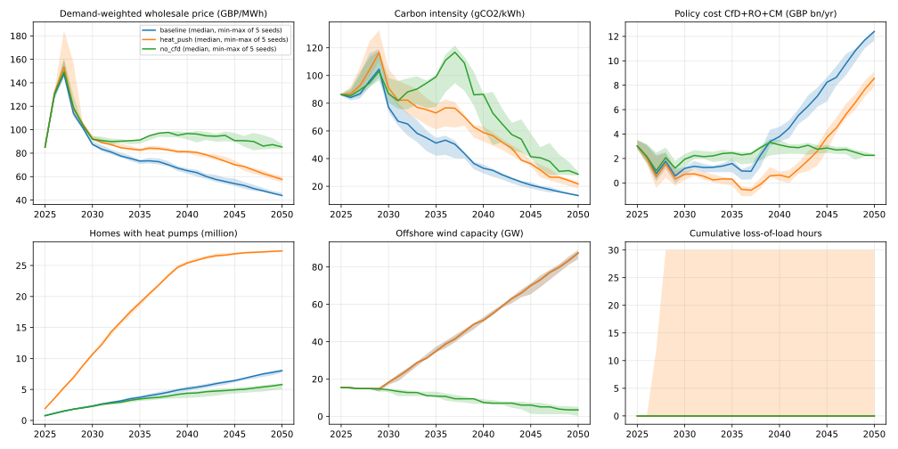
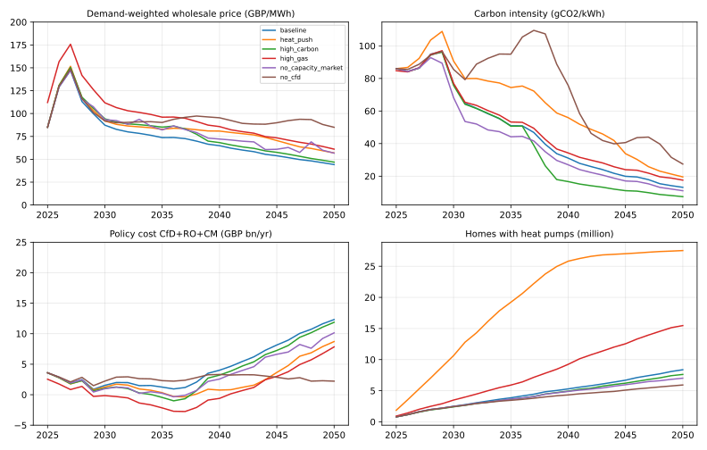

# pypsa-gb-abm — agent-based GB electricity market model linked to PyPSA-GB

A modular Python (Mesa + PyPSA) agent-based model of the **GB electricity market** — hourly operation
(bidding, dispatch, pricing) and annual investment (technology choice, expectations, CfD / Capacity
Market / carbon policy) — linked to [PyPSA-GB](https://github.com/andrewlyden/PyPSA-GB) data and its
zonal network, with **multi-energy coupling** to heat (household heat-pump agents), gas networks, EVs
and hydrogen.

> ⚠️ Prototype for a workshop. Uncalibrated; numbers are illustrative. See [assumptions](docs/assumptions.md).

* Research: [literature review](docs/research/literature_review.md) ·
  [capability-vs-challenge matrix](docs/research/capability_matrix.md) ·
  [gap analysis](docs/research/gap_analysis.md)
* Design: [model design](docs/model_design.md) · [assumptions & limitations](docs/assumptions.md)

## Quick start
```bash
pip install -e .            # numpy pandas scipy matplotlib mesa pypsa highspy
pytest -q                   # 8 tests, ~35 s
python scripts/run_scenarios.py baseline --end 2030      # ~40 s
python scripts/run_scenarios.py                          # all 6 scenarios 2025-2050 (~4 min each)
python scripts/run_ensemble.py                           # baseline, no_cfd, heat_push x 5 seeds (~15 min on 4 cores)
python scripts/make_plots.py                             # -> docs/figures/ (+ results/ensemble_summary.md)
# optional: rebuild the PyPSA-GB snapshot / run on a live clone
python scripts/extract_pypsagb_snapshot.py /path/to/PyPSA-GB
python scripts/run_scenarios.py baseline --pypsa-gb /path/to/PyPSA-GB
```
```python
from ukabm import GBMarketModel, get_scenario
m = GBMarketModel(get_scenario("heat_push"), end=2040, seed=1)
df = m.run()            # annual metrics: prices, mix, emissions, policy costs, HP/EV stock, gas tariffs

from ukabm import run_ensemble, bands
ens = run_ensemble("baseline", seeds=[1, 2, 3, 4, 5], jobs=4, end=2050)   # long format, column `seed`
b = bands(ens, ["price_twa", "intensity_g_kwh"])                        # per-year min/median/max/mean
```

## Layout
```
ukabm/config.py        technologies, fuels, policy parameters (indicative)
ukabm/agents.py        GenCo agents (offers, CfD/CM bids, NPV investment), Plant
ukabm/market.py        vectorised hourly clearing, storage arbitrage, valley-filling
ukabm/model.py         GBMarketModel (Mesa): annual loop, auctions, settlement, investment
ukabm/multienergy.py   HeatModule (household agents), GasNetworkModule, EVModule, HydrogenModule
ukabm/network.py       PyPSA zonal redispatch on the PyPSA-GB zonal network
ukabm/data/pypsagb.py  PyPSA-GB adapter (raw clone or bundled snapshot)
ukabm/scenarios.py     baseline, high_carbon, no_cfd, heat_push, no_capacity_market, high_gas
ukabm/ensemble.py      multi-seed runs (run_ensemble, parallel) and per-year bands
```

## Headline results — multi-seed ensembles (illustrative)
Median [min–max] across seeds 1–5 (`results/ensemble_summary.md`). The seed varies initial-fleet vintages
and CfD/RO split, CfD bid noise, siting draws, merchant decision order and household-agent attributes; it
does **not** vary weather, demand, fuel or carbon paths, so bands are agent/path uncertainty only.

| scenario | price 2030 (£/MWh) | price 2050 (£/MWh) | CI 2025 (g/kWh) | CI 2050 (g/kWh) | LOLE total 2025-50 (h) | HP homes 2050 (m) | offshore wind 2050 (GW) |
|---|---|---|---|---|---|---|---|
| baseline | 77 [76–80] | 31 [30–34] | 47 [47–47] | 9 [9–10] | 0 [0–0] | 6.4 [5.6–7.0] | 87 [84–89] |
| heat_push | 84 [81–85] | 48 [45–51] | 47 [47–47] | 22 [17–24] | 1 [0–21] | 27.2 [27.0–27.3] | 87 [84–89] |
| no_cfd | 83 [80–85] | 81 [73–90] | 47 [47–47] | 22 [21–25] | 3 [0–17] | 4.5 [4.1–4.7] | 3 [0–5] |

Robust across seeds: CfDs lower long-run prices (no_cfd vs baseline bands separate from ~2032) and
heat_push raises prices and carbon intensity relative to baseline (bands separate after ~2032). **Not robust:** loss-of-load hours
(0–21 h depending on seed in heat_push and no_cfd) — single-seed LOLE figures should not be quoted.
2025 is identical across seeds (the seed changes vintages, not the 2025 aggregate fleet).



### All scenarios, single seed (seed 42)
| scenario | price 2030 / 2050 (£/MWh) | CI 2050 (g/kWh) | LOLE total 2025-50 (h) | HP homes 2050 |
|---|---|---|---|---|
| baseline | 77 / 31 | 9 | 0 | 6.7 m |
| high_carbon (£300/t 2050) | 84 / 40 | 4 | 0 | 6.0 m |
| no_cfd | 82 / 89 | 26 | 7 | 4.4 m |
| no_capacity_market | 1328 / 37 | 8 | 13,228 | 3.8 m |
| heat_push (£11.5k grant, £25/MWh levy rebalancing) | 82 / 48 | 19 | 15 | 27.3 m |
| high_gas (£45/MWh_th) | 100 / 47 | 14 | 0 | 14.8 m |

Qualitative messages: CfDs drive offshore wind and lower long-run prices; removing the CM produces a
missing-money scarcity episode before merchant entry responds (classic ABM investment cycle); high gas
prices and levy rebalancing both accelerate heat-pump uptake, which raises winter peak and carbon intensity
until the fleet catches up.




## STATUS / roadmap

| area | status |
|---|---|
| Hourly GB market clearing (agent offers, ORDC scarcity, interconnector tranches) | ✅ works, unit-tested |
| Storage arbitrage (battery, pumped hydro), smart EV valley-filling, electrolysers | ✅ works (heuristic, perfect intra-day foresight) |
| Merchant investment (5 heterogeneous GenCos, NPV on re-forecast prices) | ✅ works |
| CfD allocation rounds with pots; 2-way CfD settlement | ✅ works (simplified: no £ budget) |
| T-4 Capacity Market with sloping demand curve | ✅ works (no T-1, no penalties) |
| Retirement on persistent losses / end of life | ✅ works |
| PyPSA-GB link: zonal network, ESPENI profiles, DUKES siting, IC register, CM/CfD data | ✅ works (bundled snapshot or live clone) |
| PyPSA zonal redispatch → constraint cost, zonal price siting signal | ⚠️ runs; constraint costs look **too low** (~£0.1bn vs £1–2bn outturn) — zonal transport model, random 96 hours, single GB wind shape |
| Heat-pump household agents + gas network tariff feedback | ✅ works (stylised, synthetic temperature) |
| Hydrogen: electrolysers + H2 turbine tech | ⚠️ stub-level: exogenous H2 price, no H2 storage/network |
| Batteries | ⚠️ no new merchant batteries: flat price duration under OCGT-led CM; needs BM/ancillary revenue stack |
| Strategic BM bidding, nodal/ETYS network in loop, RL agents | ❌ not started |
| Multi-seed Monte-Carlo (`run_ensemble`, `scripts/run_ensemble.py`, band plots) | ✅ works; 5 seeds run for baseline, no_cfd, heat_push. Other 3 scenarios still single-seed |
| Calibration/validation vs 2020–24 outturn, weather years | ❌ not started (seeds do not vary weather) |

**Next (priority order)**

The daily agent takes the highest unfinished item it can complete in one run. Items marked
*needs human* are decisions for the maintainer and are skipped by the agent.

1. Calibrate 2025 against outturn. Price is plausible (~£75/MWh ✅) but carbon intensity is 47 g/kWh in
   every seed vs ~125 actual ❌: 2025 generation has imports at 54 TWh, biomass 20 TWh and CCGT only 39 TWh.
   Diagnose (interconnector tranche prices, biomass costs/availability, CCGT offers), fix, and report 2025
   price, CI and generation mix vs outturn in a table.
2. Validation check: a script and test comparing the 2025 run with outturn (price, CI, generation mix)
   within tolerance bands documented in `docs/assumptions.md`, so regressions show up in CI.
3. Network stage: switch to the PyPSA-GB Reduced 32-bus network with zonal wind profiles (Scottish vs
   English wind) and representative rather than random hours. Constraint costs (~£0.1bn now) should move
   towards the £1–2bn/yr outturn.
4. Battery revenues: add a stylised BM/ancillary revenue stack so merchant batteries can enter. Then check
   Capacity Market over-procurement of OCGT (CM clears at the £75/kW cap in every year and every baseline
   seed; the target is likely too high with an unmanaged EV peak).
5. Extend ensembles to high_carbon, high_gas and no_capacity_market
   (`python scripts/run_ensemble.py <names>`) and add them to the headline table.
6. Write up the heat_push vs baseline loop (HP uptake ↔ prices ↔ gas tariffs) as a docs page, using the
   ensemble bands: the multi-energy headline result.
7. *needs human*: decide whether to extend validation to 2020–24 back-casts and multiple weather years
   (seeds currently do not vary weather), and which outturn data sources to treat as the reference.
8. *needs human*: choose what to pursue next among hydrogen (H2 storage/network vs exogenous price),
   strategic BM bidding, nodal/ETYS network in the loop, and RL agents.

## Credits
Data extracts from PyPSA-GB (MIT), which in turn uses ESPENI, DUKES, NESO and LCCC data. Framework: Mesa, PyPSA, HiGHS.
