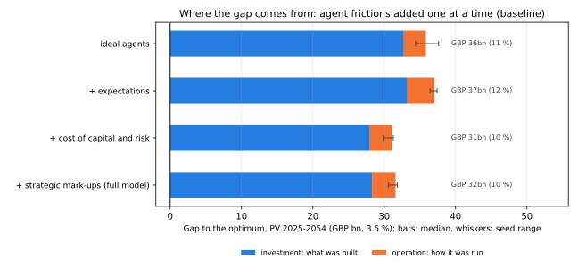
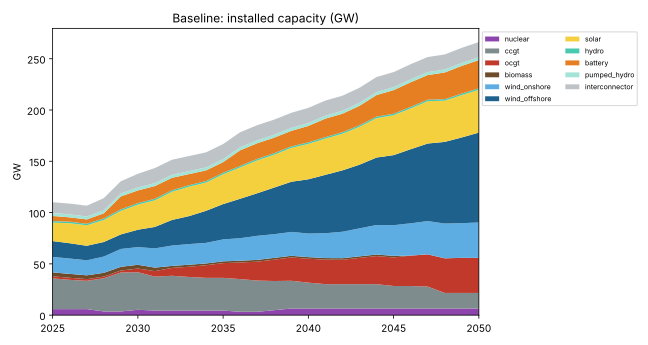

# pypsa-gb-abm — agent-based GB electricity market model linked to PyPSA-GB

A modular Python (Mesa + PyPSA) agent-based model of the **GB electricity market** — hourly operation
(bidding, dispatch, pricing) and annual investment (technology choice, expectations, CfD / Capacity
Market / carbon policy) — linked to [PyPSA-GB](https://github.com/andrewlyden/PyPSA-GB) data and its
zonal network, with **multi-energy coupling** to heat (household heat-pump agents), gas networks, EVs
and hydrogen.

> ⚠️ Prototype. The 2025 operating year is calibrated against GB outturn ([table](results/calibration_2025.md));
> the 2026-2050 pathway is not validated and numbers are illustrative. See [assumptions](docs/assumptions.md).

* Research: [literature review](docs/research/literature_review.md) ·
  [capability-vs-challenge matrix](docs/research/capability_matrix.md) ·
  [gap analysis](docs/research/gap_analysis.md)
* Design: [model design](docs/model_design.md) · [assumptions & limitations](docs/assumptions.md)

## Quick start
```bash
pip install -e .            # numpy pandas scipy matplotlib mesa pypsa highspy
pytest -q                   # 38 tests, ~5 min
python scripts/run_scenarios.py baseline --end 2030      # ~40 s
python scripts/run_scenarios.py                          # all 6 scenarios 2025-2050 (~4 min each)
python scripts/make_plots.py                             # -> docs/figures/
python scripts/compare_outturn.py                        # 2025 vs GB outturn -> results/calibration_2025.md
python scripts/run_ensemble.py                           # baseline, no_cfd, heat_push x 5 seeds
python scripts/run_gap.py                                # optimal vs emergent: planner, ladder, levers (hours)
# optional: rebuild the outturn reference / neighbour prices (public APIs, no key)
python scripts/fetch_outturn.py 2024 2025 && python scripts/fetch_neighbour_prices.py 2024
# optional: rebuild the PyPSA-GB snapshot / run on a live clone
python scripts/extract_pypsagb_snapshot.py /path/to/PyPSA-GB
python scripts/run_scenarios.py baseline --pypsa-gb /path/to/PyPSA-GB
```
```python
from ukabm import GBMarketModel, get_scenario
m = GBMarketModel(get_scenario("heat_push"), end=2040, seed=1)
df = m.run()            # annual metrics: prices, mix, emissions, policy costs, HP/EV stock, gas tariffs
```

## Layout
```
ukabm/config.py        technologies, fuels, policy parameters (indicative)
ukabm/agents.py        GenCo agents (offers, CfD/CM bids, NPV investment), Plant
ukabm/market.py        vectorised hourly clearing, storage arbitrage, valley-filling
ukabm/model.py         GBMarketModel (Mesa): annual loop, auctions, settlement, investment
ukabm/multienergy.py   HeatModule (household agents), GasNetworkModule, EVModule, HydrogenModule
ukabm/network.py       BM-style redispatch (bids/offers) on the PyPSA-GB zonal network, ETYS boundary limits
ukabm/data/pypsagb.py  PyPSA-GB adapter (raw clone or bundled snapshot)
ukabm/scenarios.py     baseline, high_carbon, no_cfd, heat_push, no_capacity_market, high_gas
ukabm/outturn.py       model-vs-outturn comparison (data/outturn: NESO generation mix + CI, Elexon)
ukabm/ensemble.py      multi-seed runs (run_ensemble, parallel) and per-year bands
ukabm/costs.py         system-cost accounting shared by every run (resource cost; transfers cancel)
ukabm/planner.py       the optimum: PyPSA multi-period capacity expansion; least-cost evaluator dispatch
ukabm/gap.py           optimal vs emergent: gap runs, investment/operation split, ladder of agent frictions
```

## 2025 calibration (baseline, seed 42) vs GB outturn
| | model | outturn 2025 |
|---|---|---|
| price, time-weighted mean (£/MWh) | 83.9 | 79.9 (Elexon MID) |
| carbon intensity, NESO basis: wholesale / after BM redispatch (g/kWh) | 113 / 124 | 130 (NESO, generation-weighted) |
| gas / wind after BM redispatch (TWh) | 76 / 87 | 77 / 86 |
| nuclear / biomass (TWh) | 35 / 20 | 34 / 20 |
| imports / exports (TWh) | 45 / 15 | 44 / 15 (Elexon FUELHH) |
| constraint cost (£bn) | 1.04 | 1.83, of which ~0.54 BM premia not modelled (LCP Delta 2026, NESO data) |
| renewable turn-down in the BM (TWh) | 7.8 | 10.4 |

The network stage redispatches the copperplate schedule on the PyPSA-GB zones with dated ETYS boundary
capabilities. It turns down Scottish wind behind B4/B6 and turns up gas in England, which closes most of the CI gap.
Remaining residuals: the model has no CHP/waste "other" generation (4.7 TWh, ~+5 g/kWh) and its price
distribution is too narrow (no negative hours). Full table: [results/calibration_2025.md](results/calibration_2025.md).

## Optimal versus emergent: the gap (illustrative)
The same system solved two ways: the agents (many actors, today's market design) and a PyPSA
multi-period least-cost plan (one planner, perfect foresight, 3.5 %), both costed by one least-cost
dispatch over 8,760 h ([method and results](docs/gap.md)). Present value of system cost 2025–2054, £bn,
median of 3 seeds:

| run | optimal | agents | gap [range] | of which investment / operation | gap % |
|---|---|---|---|---|---|
| baseline (full agents) | 315 | 346 | 32 [31–33] | 28 / 3 | 10.0 |
| baseline, idealised agents | 315 | 352 | 37 [36–38] | 33 / 4 | 11.8 |
| no_cfd | 313 | 372 | 57 [55–60] | 55 / 1 | 17.9 |
| no_capacity_market | 313 | 332 | 18 [17–18] | 14 / 3 | 5.5 |
| heat_push | 391 | 419 | 28 [28–31] | 25 / 3 | 7.2 |
| high_carbon | 314 | 345 | 32 [31–33] | 28 / 4 | 10.3 |
| high_gas | 350 | 387 | 37 [37–39] | 33 / 5 | 10.6 |

* The gap is mostly **what is built**: too little solar and onshore wind by 2030, then too much
  offshore wind, OCGT and batteries by 2050 (88 against 47 GW offshore).
* **Agent frictions explain little of it.** Idealised agents leave a larger gap (£37bn); the residual
  comes from market and plan design (CfD pots, the CM target) and sequential, myopic investment.
* **CfDs keep the system near the optimum** (without them the gap nearly doubles); the **Capacity
  Market** as modelled overshoots (without it the gap halves, at the cost of some loss of load).
* The optimum has no reserve or response requirement and sees one weather year, which overstates the
  gap (24 GW of batteries alone ≈ £1.5bn/yr in 2050); see the caveats in [docs/gap.md](docs/gap.md).




## Scenario results (illustrative)
Ensembles, median [min–max] of seeds 1–5 ([results/ensemble_summary.md](results/ensemble_summary.md)). Seeds vary
agent and path draws, not weather, demand, fuel or carbon paths.

| scenario | price 2030 (£/MWh) | price 2050 (£/MWh) | CI 2050 (g/kWh) | LOLE total 2025-50 (h) | HP homes 2050 (m) | offshore wind 2050 (GW) |
|---|---|---|---|---|---|---|
| baseline | 90 [88–91] | 36 [36–38] | 7 [6–9] | 0 [0–34] | 6.8 [6.5–7.4] | 87 [84–89] |
| heat_push | 94 [92–96] | 53 [53–55] | 17 [16–18] | 0 [0–101] | 27.1 [26.8–27.3] | 87 [84–89] |
| no_cfd | 95 [93–97] | 79 [76–81] | 26 [24–27] | 0 [0–39] | 5.0 [4.6–5.1] | 3 [0–5] |

All scenarios, seed 42:

| scenario | price 2030 / 2050 (£/MWh) | CI 2050 (g/kWh), direct (NESO basis) | LOLE total 2025-50 (h) | HP homes 2050 | batteries 2030 / 2050 (GW) |
|---|---|---|---|---|---|
| baseline | 89 / 38 | 9 (14) | 0 | 7.3 m | 5 / 26 |
| high_carbon (£300/t 2050) | 96 / 45 | 7 (11) | 0 | 6.6 m | 6 / 30 |
| no_cfd | 94 / 86 | 28 (41) | 0 | 5.0 m | 5 / 10 |
| no_capacity_market | 93 / 48 | 5 (10) | 76 | 6.8 m | 5 / 15 |
| heat_push (£11.5k grant, £25/MWh levy rebalancing) | 93 / 53 | 17 (24) | 0 | 27.2 m | 6 / 28 |
| high_gas (central gas path + £15/MWh_th) | 114 / 53 | 12 (18) | 0 | 13.7 m | 11 / 38 |

The central gas path now includes the 2026 spike (£55/MWh_th in 2026, £63 in 2027, easing to £35 by 2030;
[assumptions](docs/assumptions.md)), so wholesale prices peak at ~£147/MWh in 2027 in every scenario. CfDs
drive offshore wind and lower long-run prices; without a Capacity Market, loss of load appears from the late 2030s
(76 h over 2037–50) rather than as an early scarcity episode; high gas prices and levy rebalancing both accelerate
heat-pump uptake, which raises winter peak and carbon intensity until the fleet catches up. Loss-of-load hours
are seed-dependent (0–101 h across seeds in heat_push) and should not be quoted from one seed.




## STATUS / roadmap

| area | status |
|---|---|
| Hourly GB market clearing (agent offers, ORDC scarcity) | ✅ works, unit-tested |
| Interconnectors: per-market import offers + export bids on observed 2024 neighbour price shapes | ✅ works; calibrated to 2025 flows (45/15 TWh vs 44/15) |
| 2025 calibration vs outturn (`scripts/compare_outturn.py`) | ✅ price +6 %, gas/imports/exports/nuclear/biomass within 10 %; CI (NESO basis) −13 % with explained residuals (curtailment, "other") |
| Storage arbitrage (battery, pumped hydro), smart EV valley-filling, electrolysers | ✅ works (heuristic, perfect intra-day foresight; storage fleet dispatched in price-aware tranches) |
| Merchant investment (5 heterogeneous GenCos, NPV on re-forecast prices) | ✅ works |
| CfD allocation rounds with pots; 2-way CfD settlement | ✅ works (simplified: no £ budget) |
| T-4 Capacity Market with sloping demand curve | ✅ works (no T-1, no penalties); fixed Nov 2026: no acceptance beyond the end of the demand curve, new-build bids on the t+3 forecast. ⚠️ target ~25 % above published (roadmap) |
| Retirement on persistent losses / end of life | ✅ works |
| PyPSA-GB link: zonal network, ESPENI profiles, DUKES siting, IC register, CM/CfD data | ✅ works (bundled snapshot or live clone) |
| Network stage: BM-style redispatch (bids/offers) on PyPSA-GB zones with dated ETYS boundary capabilities and monthly availability, 96 wind-stratified hours | ✅ 2025: £1.04bn vs £1.29bn outturn excl. BM premia; 7.8 vs 10.4 TWh turn-down; post-BM gas/wind within 1.5 TWh, CI 6 g/kWh low. Boundary cuts tested for bypass routes. ⚠️ Single GB wind shape for all zones; ~£0 in 2030–35 (see roadmap); redispatch is reported only, not settled |
| Heat-pump household agents + gas network tariff feedback | ✅ works (stylised, synthetic temperature) |
| Hydrogen: electrolysers + H2 turbine tech | ⚠️ stub-level: exogenous H2 price, no H2 storage/network |
| Batteries: revenue stack (day-ahead arbitrage + ancillary and intraday/BM pots shared across the fleet + CM) | ✅ 2025 stack £64k/MW/yr before CM (Modo index £73k incl. CM); batteries enter via CM and merchant NPV, 5–11 GW by 2030 and 10–38 GW by 2050. ⚠️ Stylised pots; low against Clean Power 2030 (23–27 GW by 2030); fewer than before the CM fix, which had procured batteries at the £75/kW cap |
| Strategic BM bidding, nodal/ETYS network in loop, RL agents | ❌ not started |
| Price distribution | ⚠️ too narrow: no negative hours (244 in 2025), p05 £54 vs £9, p95 £100 vs £123 (no unit commitment / must-run, no scarcity tail) |
| Multi-seed Monte-Carlo (`run_ensemble`, band plots) | ✅ 5 seeds for baseline, no_cfd, heat_push; other scenarios seed 42 |
| System cost (resource cost, `syscost_*` columns) and planner benchmark (`ukabm.planner`) | ✅ PyPSA multi-period LP on the same inputs; least-cost evaluator for both pathways. ⚠️ copperplate, one weather year, electricity only (demand held at the agents' values) |
| Gap ladder (idealised agent trait groups) and policy levers (`ukabm.gap`, `scripts/run_gap.py`) | ✅ 3 seeds; see [docs/gap.md](docs/gap.md) |
| Back-casts 2020–24, weather years, CI tolerance test | ❌ not started (2025 only) |

**Next (priority order)**

The project's focus is the gap between the optimal and the emergent system (see
[docs/gap.md](docs/gap.md)): how large it is, where it comes from, and which market designs and plans
close it. The roadmap follows that order. The daily agent takes the highest unfinished item it can
complete in one run. Items marked *needs human* are decisions for the maintainer and are skipped by the
agent.

1. **Reserve and response in the optimum.** Agents build batteries partly for ancillary and intraday/BM
   revenue (`config.BATTERY_*` pots), but the planner and the evaluator have no reserve or frequency-
   response requirement, so those batteries count as pure cost in the gap. Add a reserve/response
   requirement (sized to give the 2025 ancillary market) to `planner.plan` and `planner.evaluate`, and
   report how much of the investment gap it removes.
2. **Gap robustness.** Re-run `scripts/run_gap.py` with 5 seeds (currently 3) and add two sensitivity
   runs of the planner: build-rate limits ×0.5 and ×2 (`config.PLANNER_BUILD_MW_PER_YEAR`), and the
   planner restricted to the agents' option set per period (no technology the agents could not build
   that year). Report how much of the gap each moves, in `docs/gap.md`.
3. **Reverse ladder.** The ladder adds frictions in one order (expectations → capital → strategic). Run
   the reverse order and the one-at-a-time removals from the full model, and report the range of each
   source's contribution (interaction effects), as a table in `docs/gap.md`.
4. **Decompose the residual "ideal agents" gap.** Most of the gap remains with idealised agents. Split it
   with scenario switches: (a) energy-only market (no CfD, no CM) with ideal agents; (b) VRE allowed
   through merchant investment as well as CfDs; (c) CM target at the published value (see item 8);
   (d) merchant decisions on a longer forecast horizon (t+3 and t+8 averaged) and more decisions per year.
   Each is a scenario key plus a ladder rung; document which candidate source (market design, limited
   information, decision procedure) each stands for.
5. **Patterns over time (deck slide 12).** (a) Tipping point: sweep `hp_grant` (£0–15k, 7 values, 3
   seeds) and plot 2050 heat-pump homes and the gap against the grant. (b) Lock-in: years between
   heat-pump/boiler lifecycle-cost parity and the year heat pumps pass 50 % of replacements. (c) Multiple
   equilibria: report seed spread of 2050 flexibility mix (batteries vs OCGT vs DSR) per scenario.
6. **Network in the gap.** Add the redispatch (constraint) cost to the agents' system cost in network years
   and give the planner the PyPSA-GB zones with the dated ETYS boundaries, so siting enters the gap.
   Then a zonal-pricing lever scenario (settle at zonal prices from the network stage).
7. **Decision-logic interface (deck slide 16).** Move `GenCo` investment, CfD and CM bidding decisions
   behind one interface (inputs: forecasts, prices, policy; outputs: decisions) with the current rules as
   the default implementation and a test that results are identical for a fixed seed. Q-learning and LLM
   agents then plug in like for like.
8. Capacity Market target. The model's T-4 target for 2029/30 is ~49 GW de-rated, against the published
   39.4 GW (2028/29: 43.7 GW target, 43.0 GW procured; Modo Energy). Auctions clear at the £75/kW cap from
   the late 2030s and OCGT reaches ~30 GW by 2050. Reconcile the target (unmanaged HP/EV peak, T-1
   holdback, de-rating factors); this feeds the market-design part of the gap.
9. Network follow-ups: constraint cost ~£0 in 2030–35 (LCP Delta projects £4–6bn in 2030); offshore build
   rate vs the 2030 pipeline; East Anglia (EC5) constraint; zonal wind profiles (Scottish vs English);
   interconnector counter-trades; post-BM CI in the headline.
10. Price distribution too narrow (no negative hours, p95 £100 vs £123 in 2025): must-run/min-stable
   generation and RO bidding. Battery capex (£600/kW for 2 h) needs a 2025 source.
11. Validation check: tolerance bands (in `docs/assumptions.md`) on the `ukabm.outturn.compare` table for
    2025 and a test, so regressions show up in CI.
12. *needs human*: multi-sector optimum. The planner holds heat-pump uptake, EV charging and electrolyser
    capacity at the agents' values. Decide whether the optimum should also choose heating technology and
    hydrogen (heat and H2 in PyPSA-GB, Lyden et al. 2024b; Dergunova and Lyden 2024), which makes
    household behaviour part of the gap.
13. *needs human*: decide whether to extend validation to 2020–24 back-casts and multiple weather years.
14. *needs human*: choose the first agent extension among Q-learning and LLM reasoning agents (deck
    slides 15–16), once item 6 exists.

## Credits
Data extracts from PyPSA-GB (MIT), which in turn uses ESPENI, DUKES, NESO and LCCC data. Framework: Mesa, PyPSA, HiGHS.
