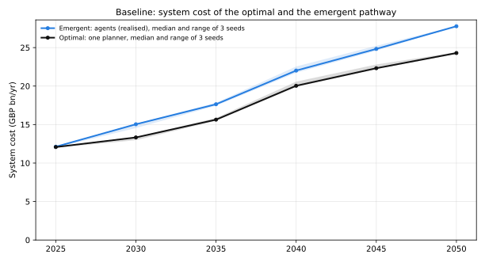
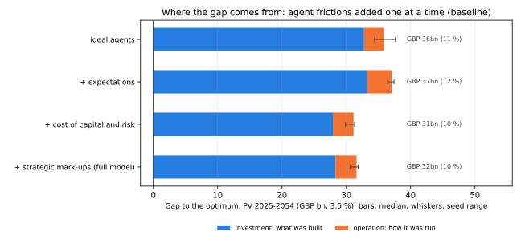
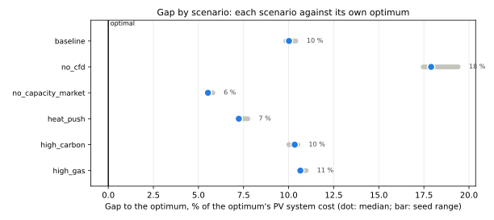

# Optimal versus emergent: the gap

The project asks how far the system that many actors build (emergent) is from the one a single planner
would build (optimal), where that gap comes from, and which market designs and plans close it. This page
reports the first measurement. **All numbers are illustrative**: one weather year, copperplate, an
uncalibrated investment model after 2025, and 3 seeds. Numbers are after the November 2026 review fixes
([review](review_2026-11.md)); the headline barely moved (£32bn, 10 %), but the planner now values
storage correctly and the agents' CM, RO and CfD settlement follow the scheme rules. Since README item 9
both the planner and the evaluator hold frequency response and operating reserve; the gap is unchanged
([below](#does-valuing-reserve-and-response-close-it)). These numbers predate the Capacity Market
clearing and agreement-tracking fixes made on the `foundations/implementation` branch, which change CM
cost and retirements.

## Method: the same system, solved two ways

* **Run 2, many actors.** The agent-based model (`GBMarketModel`) runs 2025–2050: GenCos invest on
  their own forecasts and hurdle rates through CfD rounds, the Capacity Market and merchant decisions;
  households choose heating; the hourly market clears every year.
* **Run 1, one planner.** `ukabm.planner.plan` solves a PyPSA capacity expansion over 5-year investment
  periods with perfect foresight at a 3.5 % social discount rate. It starts from the same fleet, faces
  the same technologies, costs, fuel and carbon paths, weather, interconnector markets and electrolysers,
  and meets the *same* realised inflexible demand as the agent run it is compared with. Build rates are
  limited by supply chains (`config.PLANNER_BUILD_MW_PER_YEAR`).
* **One yardstick.** Both capacity pathways are dispatched at least cost over all 8,760 hours of each
  period year by `ukabm.planner.evaluate` and costed with one definition (`ukabm.costs`): new-build
  capex, fixed O&M, fuel, carbon, net trade, unserved energy (and any reserve shortfall) and electrolyser
  value. Transfers (CfD, RO, CM payments, scarcity rents) cancel.
* **Reserve and response on both sides of the yardstick.** The planner and the evaluator hold 1,800 MW of
  frequency response on storage (with an hour of energy behind it) and operating reserve of 10 % of
  available wind and solar on thermal and storage headroom, every hour; a shortfall costs £1,000/MWh
  (`config.RESERVE`, [assumptions](assumptions.md#optimal-vs-emergent-ukabmcosts-ukabmplanner-ukabmgap)).
  The agents' market holds none, so their realised cost carries none of it.

The gap in present value 2025–2054 splits into

| part | definition | what it measures |
|---|---|---|
| investment | evaluator(agents' fleet) − evaluator(planner's fleet) | what was built, where the agents' pathway differs from the optimum |
| operation | agents' realised cost − evaluator(agents' fleet) | how the agents' fleet was run: mark-ups, heuristic storage, EV and electrolyser dispatch |
| total | agents' realised cost − evaluator(planner's fleet) | the price of decentralised decisions under this market design |

Assumptions and limitations: [assumptions.md](assumptions.md#optimal-vs-emergent-ukabmcosts-ukabmplanner-ukabmgap).

Reproduce: `python scripts/run_gap.py --jobs 11` (33 runs, ~4.5 h on 11 cores; each worker holds ~3 GB
during its planner solve, so 11 is the limit on a 32 GB machine), then
`python scripts/make_plots.py`. Outputs: `results/gap_costs.csv` (cost components by run, seed, year
and pathway), `gap_capacity.csv`, `gap_annual.csv`, `gap_summary.csv` and
[gap_summary.md](../results/gap_summary.md).

## How large is the gap?

Present value 2025–2054 at 3.5 % (£bn), for the seed with the median gap (so the columns add up),
[range across seeds 1–3]:

| run | optimal | agents | gap | investment | operation | gap % |
|---|---|---|---|---|---|---|
| ideal agents | 320 | 356 | 36 [34–38] | 33 | 3 | 11.2 |
| + expectations | 317 | 354 | 37 [36–37] | 33 | 4 | 11.7 |
| + cost of capital and risk | 316 | 348 | 31 [30–31] | 28 | 3 | 9.8 |
| **+ strategic mark-ups (full model = baseline)** | **321** | **352** | **32 [31–32]** | **28** | **3** | **9.9** |
| no_cfd | 318 | 375 | 58 [55–58] | 56 | 2 | 18.1 |
| no_capacity_market | 315 | 333 | 18 [16–18] | 14 | 4 | 5.7 |
| heat_push | 390 | 425 | 35 [34–36] | 32 | 3 | 8.9 |
| high_carbon | 310 | 346 | 35 [35–37] | 32 | 4 | 11.4 |
| high_gas | 355 | 392 | 38 [37–39] | 32 | 5 | 10.6 |
| reserve off (baseline) | 321 | 352 | 32 [31–32] | 28 | 4 | 9.9 |
| reserve ×2 (baseline) | 317 | 348 | 31 [30–31] | 28 | 3 | 9.9 |

In the baseline, decentralised decisions under today's market design cost **about £32bn more than the
optimum over 30 years, 10 % of system cost**. Nine-tenths of that is investment (what was built), one
tenth operation (how it was run). The seed range is narrow (±£1bn) next to the differences between
scenarios.

## How does it move over time?

The annual gap is £0.05bn in 2025 (same fleet), £1.7bn/yr in 2030, about £2bn/yr in 2035–40, £2.4bn/yr
in 2045 and £3.5bn/yr in 2050. Its *cause* changes along the way:

* **2030: too little, too late, and too much gas.** The planner adds solar fast (44 GW in 2030 against
  the agents' 22 GW), while the agents hold 39 GW of CCGT against the planner's 23 GW (a 2029 build
  wave on forecasts taken in the 2026–27 gas-price spike). The agents' system emits 24 Mt CO₂ against
  the optimum's 17 Mt.
* **2040–2050: too much of the wrong kind.** The agents end with 88 GW offshore wind against the
  planner's 41 GW, 25 GW of batteries against 3 GW, and 34 GW OCGT against 8 GW; the planner has more
  onshore wind (58 against 35 GW, at its build limit) and 11 GW of gas CCS that the agents do not build.
  The agents' system emits more than the optimum throughout (6.6 against 4.8 Mt in 2050): offshore wind
  does not displace the gas that the planner's CCS does.
* **The optimum chooses some loss of load.** From 2035 the planner leaves 1–100 GWh/yr unserved
  (£0.6bn/yr at £6,000/MWh in 2050) and runs ~20 GWh/yr short of reserve rather than build peakers; the
  agents, held to the 3 h reliability standard by the CM, leave none.

In 2050 the fleet differences cost roughly (annuity + FOM, £bn/yr): offshore wind +9.2, onshore wind
−2.6, gas CCS −1.8, batteries +1.3, OCGT +1.2, CCGT +0.7, solar −0.2; net +7.8, of which fuel, trade
and unserved-energy savings recover a little over half.

## Where does it come from?

The ladder idealises all agent trait groups (adaptive expectations without bias, a 3.5 % hurdle rate,
no risk aversion or budget limit, no mark-up) and then restores them one group at a time.

* **Ideal agents still leave £36bn, largely because the agents do not decide volumes.** In these runs
  (government `fixed`, rule-based bids) each CfD round procures a fixed 6 GW (60 % offshore, 20 %
  onshore, 20 % solar), and the firms' bids never reach the administrative caps, so every round fills:
  3.6 GW of offshore wind a year is the 88 GW reached by 2050. The CM target is a fixed formula and sets
  most of the firm capacity. Firms only decide who builds, at what strike price (a transfer), and a few
  merchant gas and battery projects. The residual therefore measures the fixed plan (CfD volumes, CM
  target) and the decision procedure (sequential, myopic NPV), not decentralised choice. Items 1–7 make
  the government, the system operator and the firms' bids real decisions (`government: "targets"`,
  `system_operator: "standard"`, `decision_logic: "expectations"`); the headline runs do not use them
  yet.
* **Frictions narrow the gap.** Restoring the cost of capital and risk *reduces* the gap by £6bn: in a
  system where policy already pushes too much capacity, dearer capital curbs over-build. This is a
  second-best result: removing one distortion while others remain need not help.
* **Expectations and mark-ups barely move it.** CfD bids under the rules do not use the price forecast,
  and CfD and CM volumes are fixed, so expectations can only act on the few merchant decisions;
  strategic mark-ups are transfers: they change prices, not the merit order or the build.
* **Operation (~£3–4bn)** comes from heuristic storage, EV and electrolyser dispatch and trade, not from
  mark-ups (the operation gap is the same with and without them).

The order of the ladder matters; README item 21 runs every order, with government and firm rungs.

## Does valuing reserve and response close it?

Review finding B3 was that the agents' batteries earn ancillary-service and trading pots for services
the optimum did not have to provide, so part of the battery build might be system value the yardstick
could not see. README item 9 adds the requirement to both the planner and the evaluator
([method](#method-the-same-system-solved-two-ways)); the sensitivities switch it off and double it
(response 3.6 GW, reserve 20 % of available wind and solar).

| baseline, PV £bn (median of 3 seeds, by column) | optimal | agents (evaluated) | gap | 2050 batteries, optimum |
|---|---|---|---|---|
| reserve off | 316.4 | 344.9 | 31.7 | 0.3 GW |
| reserve on (default) | 316.5 | 345.0 | 31.7 | 2.9 GW |
| reserve ×2 | 316.9 | 345.2 | 31.4 | 5.0 GW |

**It does not close the gap.** Holding the requirement costs the optimum about £0.1bn over 30 years
(£0.5bn when doubled), and the agents' fleet, with its 25 GW of batteries and 34 GW of OCGT, holds it at
almost no extra cost. The optimum meets it mostly from headroom on gas plant and existing pumped hydro,
adds 2–3 GW of batteries for response (5 GW when doubled), and from 2035 chooses to run ~20 GWh/yr
short at £1,000/MWh rather than build more. So the system needs a few GW of fast storage for these
services, not 25: **the agents' battery build follows their revenue assumptions (the fixed ancillary
and trading pots, `config.BATTERY_*`, and price arbitrage), not reserve and response value**, and the
£1.3bn/yr of excess batteries in 2050 stays in the gap. The Capacity Market is not needed for it: the
energy-only convergence run below also ends with 26 GW against the optimum's 3 GW. The requirement
has a side effect in the optimum: the batteries it adds also cut unserved energy (100 against 131 GWh in
2050).

Two limits: the requirement is a simple stand-in (a fixed response volume and a share of variable
output, no inertia, no dynamic sizing, no locational constraints), and the agents' ancillary pot is still
a fixed £100m/yr rather than a price for this requirement, so the two sides value the same service in
different ways (README item 0, B3).

## Which market designs close it?

* **Without CfDs the gap nearly doubles (£58bn, 18 %).** Merchant investors build too little: £51bn
  less capex and £21bn less FOM, but £66bn more fuel, £25bn more carbon, £31bn more net imports and
  £12bn less electrolyser value. CfDs are the main tool that keeps the emergent system near the
  optimum, even though the pot design overshoots offshore.
* **Without the Capacity Market the gap halves (£18bn, 5.6 %).** The CM buys peakers and batteries the
  optimum does not need (34 against 15 GW OCGT in 2050). Caveat: the planner sees one weather year and
  values unserved energy at £6,000/MWh only; it gives the CM no credit for insurance against cold, still
  years or plant outages, and the agents' no-CM run does have 79 h of loss of load over 2033–50 in seed
  42. The gap is measured against a planner that itself accepts loss of load; a planner held to the
  same 3 h standard would make the CM look better.
* **heat_push** has a smaller gap in % (9 %) on a larger system; **high_carbon** and **high_gas** leave
  it at 11–12 %.

## Convergence test: can the agents reach the optimum at all?

Before reading the gap as the cost of a market design, the agents must be able to get close to the
optimum when the textbook conditions hold. `scripts/run_convergence.py` runs the scenario
`competitive_benchmark`: an energy-only market with scarcity priced at VoLL only, no new CfDs and no
CM (legacy contracts run on as transfers), idealised firms (3.5 % hurdle, no risk aversion, budget or mark-up) investing merchant on lifetime price
forecasts (`decision_logic: "expectations"`). Aim: a gap below 3 % ([summary](../results/convergence_summary.md)).

| seed | optimal | agents | gap | investment | operation | gap % |
|---|---|---|---|---|---|---|
| 1 | 315 | 323 | 8.1 | 2.2 | 5.9 | 2.6 |
| 2 | 317 | 330 | 12.7 | 5.3 | 7.4 | 4.0 |
| 3 | 312 | 322 | 10.2 | 4.1 | 6.2 | 3.3 |

The median gap is **3.3 %, close to the aim, and most of it is operation, not investment**. The investment
gap is £2–5bn although the 2050 fleets differ a lot (agents against optimum: 98 against 58 GW onshore,
12 against 39 GW offshore, 26 against 46 GW solar, 26 against 3 GW batteries). With the reserve
requirement on both sides (item 9) the result is the same as without it to within £0.2bn per seed. The cost surface is
flat: very different fleets cost nearly the same. A £ gap alone therefore cannot say whether the agents
found *the* optimum; roadmap item 10 maps the near-optimal space (MGA) so that a fleet can be reported as
inside or outside the band of fleets within, say, 1–5 % of the least cost.

The result is an upper bound on the cost of the decision procedure itself, because three asymmetries
remain between the two sides:

1. **Different option sets.** The planner is held to 2.5 GW/yr of onshore wind
   (`PLANNER_BUILD_MW_PER_YEAR`); the agents are not, and build 98 GW. The cheap onshore the agents
   choose is not open to the planner, which makes the planner dearer and the gap smaller. A fair test
   applies the same limits to both (item 20).
2. **Battery revenue that is not priced on both sides.** The agents' batteries earn fixed ancillary and
   trading pots; the optimum now holds a reserve and response requirement (item 9), which justifies
   about 3 GW of batteries, not 26. In a textbook benchmark the pots should be off, or derived from the
   requirement (review finding B3).
3. **Heuristic operation.** By 2050 the agents' realised dispatch has ~£0.5bn/yr of unserved energy and
   £0.2–0.4bn/yr worse interconnector trade than the optimised evaluator on the same fleet, plus
   £0.3bn/yr less electrolyser value (seed 3). Storage, interconnectors and electrolysers are run by
   heuristics, so part of the operation gap measures those heuristics rather than the market.

## Caveats that bias the gap

* **Reserve and response are simple stand-ins.** The requirement in the optimum and the evaluator
  ([above](#does-valuing-reserve-and-response-close-it)) has fixed sizes and no inertia or location, and
  the agents' market does not hold it, so their realised cost is slightly understated (about £0.1bn on
  their fleet).
* **One weather year, copperplate (overstates the gap).** The planner's onshore-heavy fleet with
  almost no storage, which accepts some loss of load, is not stress-tested against other years, and
  neither pathway pays for network reinforcement (offshore wind and onshore wind sit in different
  places). README items 26 and 17.
* **Build limits shape the optimum.** The planner may build 2.5 GW/yr of onshore wind and 6 GW/yr of
  solar and reaches the onshore limit; tighter planning constraints would raise its cost and shrink the
  gap, and applying them to the agents too changes the comparison (convergence test above). README
  item 20 tests the sensitivity.
* **Demand is held at the agents' values**, so the optimum does not choose heat-pump uptake or EV
  charging; a multi-energy optimum is README items 14–15.
* **3 seeds; investment model not validated after 2025.** Treat the numbers as an order of magnitude
  and the comparisons between runs as the result.
