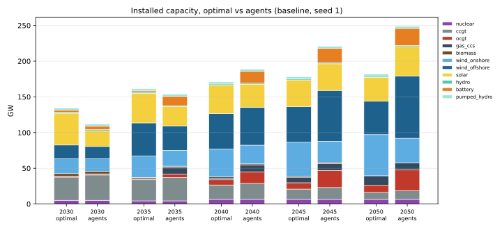

# Optimal versus emergent: the gap

The project asks how far the system that many actors build (emergent) is from the one a single planner
would build (optimal), where that gap comes from, and which market designs and plans close it. This page
reports the first measurement. **All numbers are illustrative**: one weather year, copperplate, an
uncalibrated investment model after 2025, and 3 seeds.

## Method: the same system, solved two ways

* **Run 2, many actors.** The agent-based model (`GBMarketModel`) runs 2025–2050: GenCos invest on
  their own forecasts and hurdle rates through CfD rounds, the Capacity Market and merchant decisions;
  households choose heating; the hourly market clears every year.
* **Run 1, one planner.** `ukabm.planner.plan` solves a PyPSA capacity expansion over 5-year investment
  periods with perfect foresight at a 3.5 % social discount rate. It starts from the same fleet, faces
  the same technologies, costs, fuel and carbon paths, weather, interconnector markets and electrolysers,
  and meets the *same* realised inflexible demand as the agent run it is compared with. Build rates are
  limited by supply chains (`config.PLANNER_BUILD_MW_PER_YEAR`).
* **One yardstick.** Both capacity pathways are dispatched at least cost over all 8,760 hours of each
  period year by `ukabm.planner.evaluate` and costed with one definition (`ukabm.costs`): new-build
  capex, fixed O&M, fuel, carbon, net trade, unserved energy and electrolyser value. Transfers (CfD, RO,
  CM payments, scarcity rents) cancel.

The gap in present value 2025–2054 splits into

| part | definition | what it measures |
|---|---|---|
| investment | evaluator(agents' fleet) − evaluator(planner's fleet) | what was built, where the agents' pathway differs from the optimum |
| operation | agents' realised cost − evaluator(agents' fleet) | how the agents' fleet was run: mark-ups, heuristic storage, EV and electrolyser dispatch |
| total | agents' realised cost − evaluator(planner's fleet) | the price of decentralised decisions under this market design |

Assumptions and limitations: [assumptions.md](assumptions.md#optimal-vs-emergent-ukabmcosts-ukabmplanner-ukabmgap).

Reproduce: `python scripts/run_gap.py --jobs 12` (27 runs, ~2 h on 12 cores), then
`python scripts/make_plots.py`. Outputs: `results/gap_costs.csv` (cost components by run, seed, year
and pathway), `gap_capacity.csv`, `gap_annual.csv`, `gap_summary.csv` and
[gap_summary.md](../results/gap_summary.md).

## How large is the gap?

Present value 2025–2054 at 3.5 % (£bn), median of seeds 1–3, [range]:

| run | optimal | agents | gap | investment | operation | gap % |
|---|---|---|---|---|---|---|
| ideal agents | 315 | 352 | 37 [36–38] | 33 | 4 | 11.8 |
| + expectations | 315 | 352 | 37 [36–37] | 33 | 4 | 11.6 |
| + cost of capital and risk | 315 | 346 | 32 [31–32] | 29 | 3 | 10.0 |
| **+ strategic mark-ups (full model = baseline)** | **315** | **346** | **32 [31–33]** | **28** | **3** | **10.0** |
| no_cfd | 313 | 372 | 57 [55–60] | 55 | 1 | 17.9 |
| no_capacity_market | 313 | 332 | 18 [17–18] | 14 | 3 | 5.5 |
| heat_push | 391 | 419 | 28 [28–31] | 25 | 3 | 7.2 |
| high_carbon | 314 | 345 | 32 [31–33] | 28 | 4 | 10.3 |
| high_gas | 350 | 387 | 37 [37–39] | 33 | 5 | 10.6 |

In the baseline, decentralised decisions under today's market design cost **about £32bn more than the
optimum over 30 years, 10 % of system cost**. Nine-tenths of that is investment (what was built), one
tenth operation (how it was run). The seed range is narrow (±£1bn) next to the differences between
scenarios.

## How does it move over time?

The annual gap is £0.05bn in 2025 (same fleet), £1.3bn/yr in 2030, about £2bn/yr in 2035–40 and
£3.9bn/yr in 2050. Its *cause* changes along the way:

* **2030: too little, too late.** The planner adds solar and onshore wind fast (44 GW solar in 2030
  against the agents' 22 GW) and burns less gas: 19 Mt CO₂ against the agents' 24 Mt.
* **2040–2050: too much of the wrong kind.** The agents end with 88 GW offshore wind against the
  planner's 47 GW, 24 GW of batteries against none, and 29 GW OCGT against 10 GW; the planner has more
  onshore wind (58 against 35 GW) and gas CCS. After 2035 the agents' system emits *less* than the
  optimum, because the CfD offshore pot and the CM buy low-carbon capacity beyond its least-cost level
  at the modelled carbon price.

In 2050 the fleet differences cost roughly (annuity + FOM, £bn/yr): offshore wind +8.0, onshore wind
−2.6, batteries +1.5, OCGT +0.9, solar +0.3, gas CCS −0.6; net +7.4, of which fuel, trade and
electrolyser savings recover about half.

## Where does it come from?

The ladder idealises all agent trait groups (adaptive expectations without bias, a 3.5 % hurdle rate,
no risk aversion or budget limit, no mark-up) and then restores them one group at a time.

* **Ideal agents still leave £37bn, largely because the agents do not decide volumes.** Each CfD round
  procures a fixed 6 GW (60 % offshore, 20 % onshore, 20 % solar), and the firms' bids (levelised cost
  ± noise, around £50–60/MWh) never reach the administrative caps, so every round fills: 3.6 GW of
  offshore wind a year is the 88 GW reached by 2050. The CM target is a fixed formula (~25 % above the
  published target) and sets most of the firm capacity. Firms only decide who builds, at what strike
  price (a transfer), and a few merchant gas and battery projects. The residual therefore measures the
  fixed plan (CfD volumes, CM target) and the decision procedure (sequential, myopic NPV), not
  decentralised choice. The roadmap now starts by making the government, the system operator and the
  firms' bids real decisions ([roadmap](roadmap.md), README items 1–7).
* **Frictions narrow the gap.** Restoring the cost of capital and risk *reduces* the gap by £5bn: in a
  system where policy already pushes too much capacity, dearer capital curbs over-build. This is a
  second-best result: removing one distortion while others remain need not help.
* **Expectations and mark-ups barely move it.** CfD bids do not use the price forecast at all, and CfD
  and CM volumes are fixed, so expectations can only act on the few merchant decisions; strategic
  mark-ups are transfers: they change prices, not the merit order or the build.
* **Operation (~£3bn)** comes from heuristic storage, EV and electrolyser dispatch and trade, not from
  mark-ups (the operation gap is the same with and without them).

The order of the ladder matters; README item 21 runs every order, with government and firm rungs.

## Which market designs close it?

* **Without CfDs the gap nearly doubles (£57bn, 18 %).** Merchant investors build too little: £61bn
  less capex and £26bn less FOM, but £81bn more fuel, £18bn more carbon, £33bn more imports and no
  electrolyser output. CfDs are the main tool that keeps the emergent system near the optimum, even
  though the pot design overshoots offshore.
* **Without the Capacity Market the gap halves (£18bn, 5.5 %).** The CM (with its high target) buys
  peakers and batteries the optimum does not need. Caveat: the planner sees one weather year and values
  unserved energy at £6,000/MWh only; it gives the CM no credit for insurance against cold, still years
  or plant outages, and the agents' no-CM run does have 76 h of loss of load over 2037–50 in seed 42.
* **heat_push** has a smaller gap in % (7 %) on a larger system; **high_carbon** and **high_gas** leave
  it at 10–11 %.

## Caveats that bias the gap

* **No reserve or response in the optimum (overstates the gap).** The agents' batteries earn ancillary
  and intraday/BM revenue that the planner does not need to provide; 24 GW of batteries cost about
  £1.5bn/yr in 2050. README item 9 adds a reserve/response requirement to both the planner and the
  evaluator.
* **One weather year, copperplate (overstates the gap).** The planner's onshore-heavy fleet with no
  storage is not stress-tested against other years, and neither pathway pays for network reinforcement
  (offshore wind and onshore wind sit in different places). README items 26 and 17.
* **Build limits shape the optimum.** The planner may build 2.5 GW/yr of onshore wind and 6 GW/yr of
  solar; tighter planning constraints would raise its cost and shrink the gap. README item 20 tests the
  sensitivity.
* **Demand is held at the agents' values**, so the optimum does not choose heat-pump uptake or EV
  charging; a multi-energy optimum is README items 14–15.
* **3 seeds; investment model not validated after 2025.** Treat the numbers as an order of magnitude
  and the comparisons between runs as the result.
