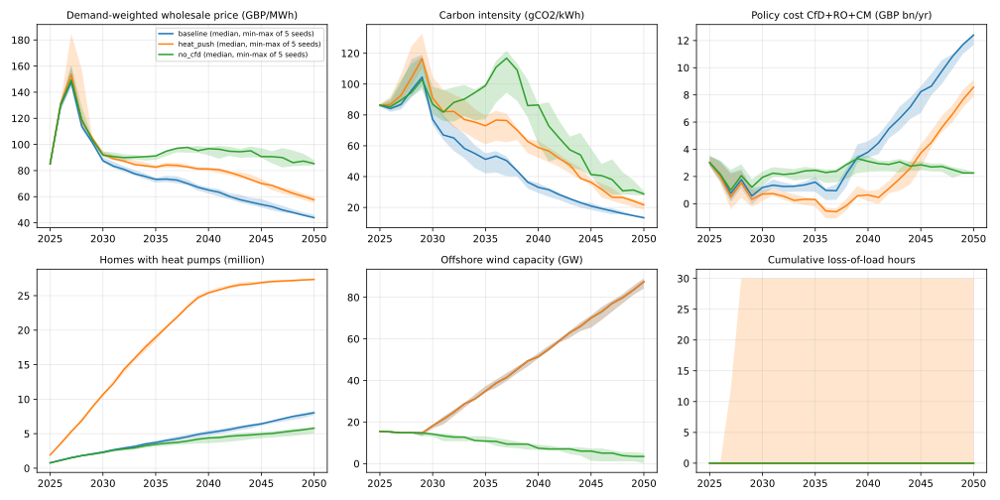
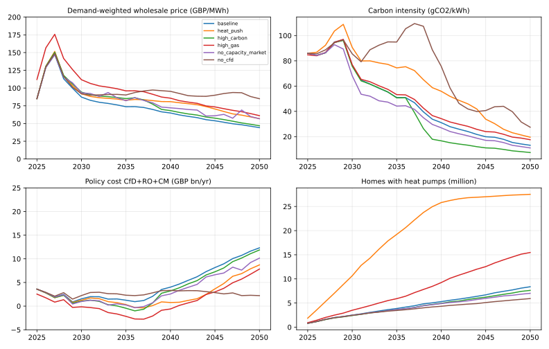
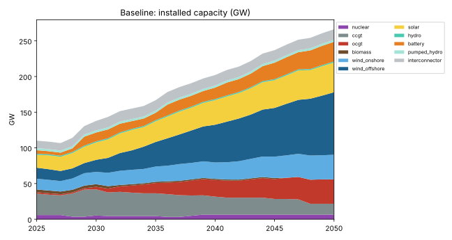
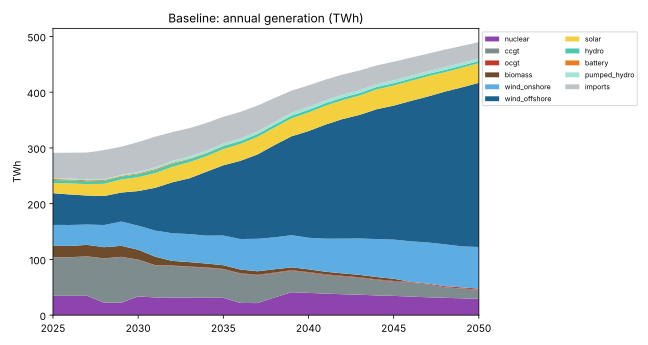
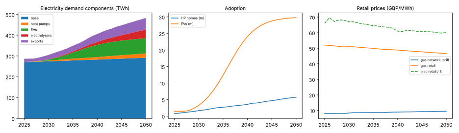
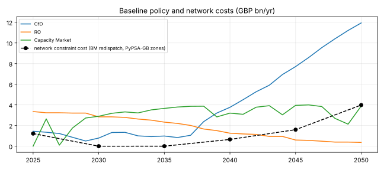
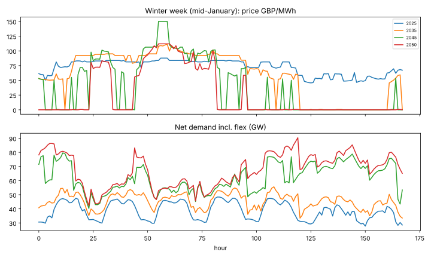
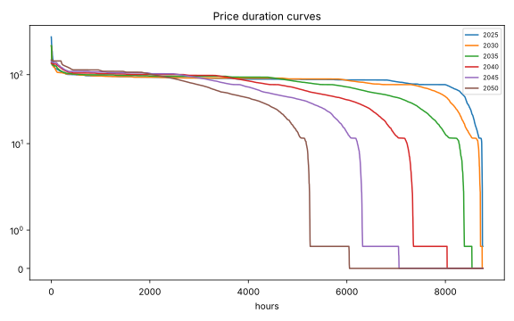
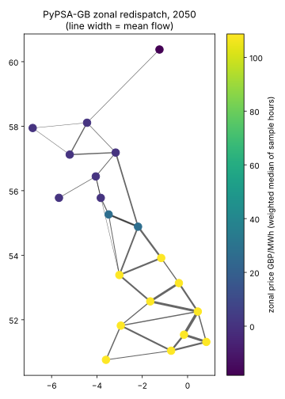

# Agent-based modelling of the GB (multi-)energy market

**What:** a Mesa + PyPSA agent-based model of the GB electricity market (operation + investment + policy),
linked to [PyPSA-GB](https://github.com/andrewlyden/PyPSA-GB), with heat, gas, EV and hydrogen coupling.
**Status:** prototype — 2025 operation calibrated against GB outturn ([assumptions](assumptions.md#2025-calibration-vs-outturn)); 2026-2050 pathway illustrative.

## 1. Research
* [Literature & framework survey](research/literature_review.md) — AMIRIS, EMLab-Generation, ASSUME, PowerACE, ElecSim, AMES, Mesa, CNZ heat ABM, EV & H2 ABMs, PyPSA-GB.
* [Capability vs UK challenge matrix](research/capability_matrix.md) ([CSV](research/capability_matrix.csv))
* [Gap analysis & scope decision](research/gap_analysis.md)

## 2. Model design
* [Architecture, agents, annual loop, extension hooks](model_design.md)
* [Assumptions & limitations](assumptions.md)

## 3. Results (baseline + 5 scenarios, 2025-2050)
Multi-seed bands (median, min–max of 5 seeds) for baseline, no_cfd and heat_push:


Single seed, all scenarios:









## 4. Usage
```bash
pip install -e . && pytest -q
python scripts/run_scenarios.py && python scripts/make_plots.py
```
See the [README](https://github.com/andrewlyden/pypsa-gb-abm#readme) for the STATUS / roadmap.
